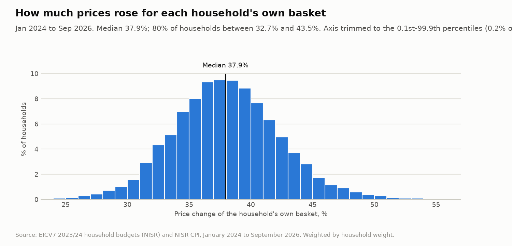
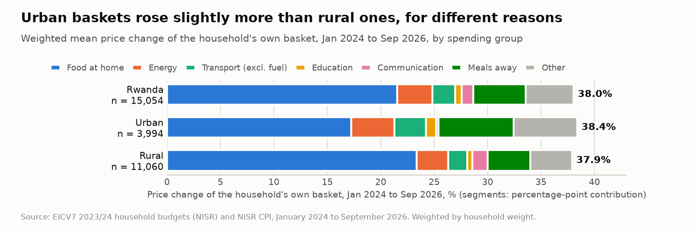
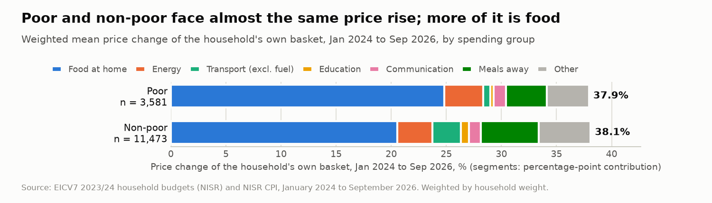
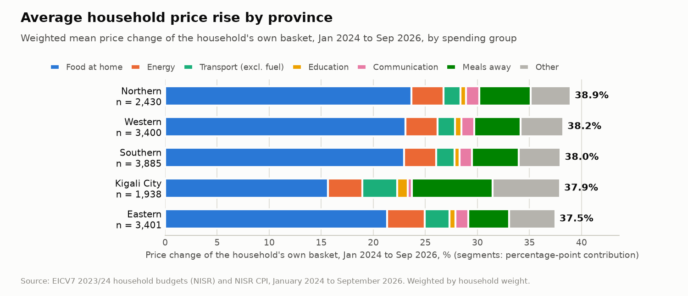
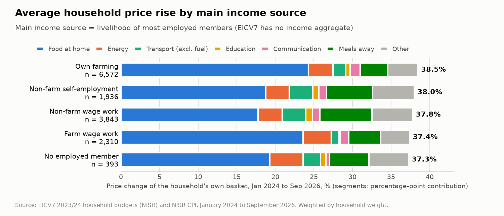
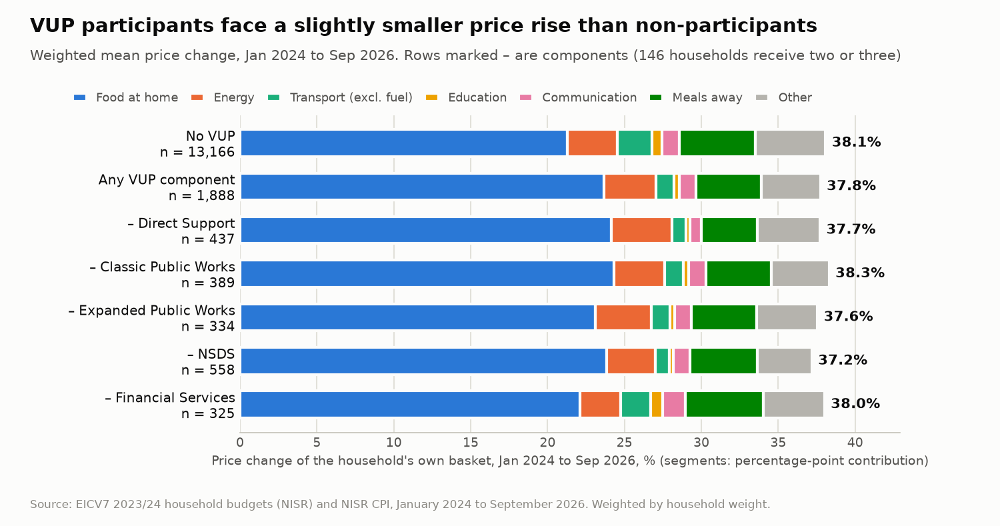

# Household CPI shock: results summary

Run on 2026-10-16.

- **Notebook:** `notebooks/07_household_cpi_shock.ipynb`
- **Output:** `data/processed/household_cpi_shock.parquet` (15,054 rows × 65 columns)
- **Method:** `docs/household_cpi_shock_methodology.md`
- **Item mapping and rural fallbacks:** `docs/expenditure_cpi_mapping.md`

**What is measured.** The price change of each household's own EICV7 basket between January 2024 and September 2026 (32 months). Urban households are priced with urban CPI indices and rural households with rural indices. Averages use the household weight (`weight`) and standard errors (SE) reflect the survey design (strata and clusters).

## Final checks

All pass.

| Check | Result |
|---|---|
| One row per household | 15,054 rows, `hhid` unique |
| No future CPI data | The CPI file ends in September 2026; only January 2024 and September 2026 values are used |
| No FinScope household join | No FinScope input or column in the master table or the output |
| Weighted poverty rate reproduces 27.4% | 27.37% (`pop_wt`) |
| Decomposition adds up | The spending-group contributions sum to each household's total |
| Rural fallbacks only affect rural households | Yes |
| Rural households are priced with rural indices only | Yes |

## Headline results

- **The typical household's basket costs 37.9% more than in January 2024** (weighted median; mean 38.0%). That is 12.8% a year. 80% of households fall between 32.7% and 43.5%.
- **This is above published headline CPI** for the same months: 33.4% urban, 36.2% rural. The bridge below explains the gap in three steps.

| Step | Urban | Rural |
|---|---:|---:|
| Published headline CPI, Jan 2024 → Sep 2026 | 33.4% | 36.2% |
| + Aggregation gap: published components × the CPI's own weights | +1.0 pp → 34.4% | +1.6 pp → 37.8% |
| + Spending-share effect: EICV7 household shares, indices common to both areas | +1.8 pp → 36.2% | +0.1 pp → 37.9% |
| + Urban-only indices (energy, fresh, local, imported) | +2.1 pp → **38.4%** | none → **37.9%** |

  - **Aggregation gap.** NISR's headline cannot be rebuilt exactly from its published components and weights, so part of the difference is not about households at all.
  - **Spending shares matter mainly in urban areas.** EICV7 households spend more than the CPI weights assume on vegetables (+5.9 pp urban, +4.1 pp rural) and meals away (+3.0 / +2.5 pp). They spend less on transport, housing and alcohol, which offsets most of it in rural areas.
  - **The urban energy index** (+54%) adds the rest for urban households.
- **Food at home is the main driver.** It contributes 21.6 percentage points of the 38.0% average.
- **For the median household, buying the same basket costs about 747,000 RWF more per year** (285,000 RWF per adult equivalent).
- **Differences between groups are small.** Every group average lies between 36.3% and 39.7%. Group differences reflect *what* households buy, because everyone in an area faces the same index changes.

## Average shock by group

| Comparison | First group | Second group | Difference | SE of difference | Reading |
|---|---:|---:|---:|---:|---|
| **Poor vs non-poor** | 37.9% (SE 0.09) | 38.1% (SE 0.05) | −0.15 pp | 0.10 | Not statistically different |
| **Rural vs urban** | 37.9% (SE 0.06) | 38.4% (SE 0.08) | −0.48 pp | 0.10 | Small. Its sign reverses under like-for-like indices (see caveats) |
| **VUP participants vs non-participants** | 37.8% (SE 0.11) | 38.1% (SE 0.05) | −0.33 pp | 0.11 | Small. Participants slightly lower |

Category shocks, as weighted household means. The share is of the basket; the shock is in percentage points of the total.

| Category | Share, rural | Share, urban | Price change, rural | Price change, urban | Shock, rural | Shock, urban |
|---|---:|---:|---:|---:|---:|---:|
| Food at home | 54.2% | 42.2% | 43.0% | 40.5% | 23.4 pp | 17.2 pp |
| Energy | 11.2% | 7.5% | 26.2%* | 54.0% | 3.0 pp | 4.1 pp |
| Transport (incl. fuel) | 2.6% | 6.0% | 71.1% | 55.6% | 1.9 pp | 3.3 pp |
| Education | 1.1% | 3.0% | 44.3% | 31.2% | 0.5 pp | 0.9 pp |
| Communication | 1.3% | 2.0% | 113.2%** | 11.6% | 1.5 pp | 0.2 pp |

\* Rural fallback indices (rural housing and transport divisions); there is no rural energy index.
\*\* Includes two flagged jumps in the rural communication index (October 2024 and August 2026).

## Charts

### 1. Distribution of the shock

The typical household's basket costs 37.9% more than in January 2024, with 80% of households between 32.7% and 43.5%. That is above published headline CPI (urban 33.4%, rural 36.2%; see the bridge above); food at home contributes 21.6 pp of the average.

### 2. Rural vs urban

Urban 38.4% vs rural 37.9% (+0.5 pp, SE 0.10). The groups' contributions differ most for food at home (−6.1 pp), meals away (+3.0 pp) and other spending (+2.0 pp). With only the indices published for both areas, urban falls to 36.2% (rural 37.9%), so which area faces the larger rise depends on the urban-only energy index.

### 3. Poor vs non-poor

Poor 37.9% vs non-poor 38.1% (−0.15 pp, SE 0.10), not statistically different. Food at home adds 4.3 pp more for the poor, while transport (−1.9 pp) and meals away (−1.5 pp) add less, so the totals largely cancel.

### 4. By province

The Northern Province has the highest average rise (38.9%) and the Eastern Province the lowest (37.5%). Of the 1.5 pp gap, contributions differ most for food at home (+2.3 pp) and meals away (+1.0 pp).

### 5. By main income source

Own-farming households face the largest rise (38.5%) and households with no employed member the smallest (37.3%). Contributions differ most for food at home (+5.0 pp) and meals away (−1.5 pp). "Main income source" is the livelihood of most employed members, because EICV7 has no income aggregate.

### 6. By VUP participation

VUP participants face 37.8% vs 38.1% for non-participants (−0.33 pp, SE 0.11). Contributions differ most for food at home (+2.4 pp), transport excluding fuel (−1.0 pp) and meals away (−0.7 pp).

## Districts: top and bottom 10 by average shock

Weighted means (household weight). The district range is 36.3% to 39.7%. Food at home is the largest contributor in every district.

**Top 10**

| Rank | District | Province | Rural share | Mean shock | SE | Food, pp | Energy, pp | Communication, pp |
|---:|---|---|---:|---:|---:|---:|---:|---:|
| 1 | Kamonyi | Southern | 68% | 39.7% | 0.28 | 24.2 | 2.9 | 1.2 |
| 2 | Gakenke | Northern | 95% | 39.5% | 0.24 | 25.6 | 2.9 | 1.4 |
| 3 | Nyamagabe | Southern | 92% | 39.3% | 0.24 | 27.0 | 2.2 | 1.0 |
| 4 | Rulindo | Northern | 89% | 39.2% | 0.25 | 25.7 | 2.7 | 1.5 |
| 5 | Rutsiro | Western | 94% | 39.1% | 0.28 | 26.7 | 2.0 | 1.4 |
| 6 | Muhanga | Southern | 78% | 39.1% | 0.25 | 23.0 | 3.1 | 1.1 |
| 7 | Burera | Northern | 91% | 38.9% | 0.20 | 23.8 | 3.3 | 1.2 |
| 8 | Musanze | Northern | 51% | 38.9% | 0.24 | 21.7 | 3.2 | 0.8 |
| 9 | Ngoma | Eastern | 91% | 38.5% | 0.30 | 24.5 | 4.1 | 1.4 |
| 10 | Kayonza | Eastern | 86% | 38.5% | 0.33 | 23.5 | 3.0 | 1.2 |

**Bottom 10**

| Rank | District | Province | Rural share | Mean shock | SE | Food, pp | Energy, pp | Communication, pp |
|---:|---|---|---:|---:|---:|---:|---:|---:|
| 21 | Nyanza | Southern | 91% | 37.7% | 0.29 | 23.9 | 3.4 | 1.1 |
| 22 | Nyabihu | Western | 75% | 37.7% | 0.23 | 22.7 | 3.2 | 1.2 |
| 23 | Kirehe | Eastern | 93% | 37.7% | 0.24 | 21.5 | 3.7 | 1.6 |
| 24 | Bugesera | Eastern | 60% | 37.2% | 0.28 | 19.9 | 3.5 | 1.2 |
| 25 | Gisagara | Southern | 97% | 37.2% | 0.27 | 23.8 | 2.3 | 1.4 |
| 26 | Huye | Southern | 83% | 37.1% | 0.23 | 20.5 | 4.0 | 1.2 |
| 27 | Ruhango | Southern | 89% | 36.9% | 0.23 | 19.7 | 3.9 | 1.2 |
| 28 | Gatsibo | Eastern | 90% | 36.8% | 0.25 | 19.6 | 3.0 | 1.3 |
| 29 | Nyaruguru | Southern | 97% | 36.4% | 0.21 | 21.1 | 2.9 | 1.4 |
| 30 | Nyagatare | Eastern | 76% | 36.3% | 0.34 | 20.5 | 4.4 | 1.1 |

Neighbouring ranks are often within about two standard errors of each other, so treat the ordering as indicative within each list. The gap between the top and bottom groups (about 3 pp) is clear.

## Cost-of-Living Distress Score

The score averages six 0–1 components with equal weights: inflation, food share, poverty vulnerability, income instability, savings and credit gap, and no VUP coverage. Higher means more distress. Its definition is in methodology section 5.

| Group | Mean score | SE |
|---|---:|---:|
| Urban | 50.1 | 0.42 |
| Rural | 60.2 | 0.17 |
| Poor | 69.5 | 0.22 |
| Non-poor | 53.5 | 0.17 |
| Farm wage work | 68.5 | 0.28 |
| Own farming | 60.6 | 0.18 |
| Non-farm wage work | 50.0 | 0.35 |

| Distress quintile | Mean price change | Poor (% of people) | Rural (% of households) | Mean food share |
|---|---:|---:|---:|---:|
| 1 (lowest) | 36.5% | 3.5% | 45% | 32.8% |
| 3 | 37.6% | 18.4% | 77% | 48.9% |
| 5 (highest) | 40.4% | 65.3% | 83% | 59.5% |

- **The ranking is robust.** Dropping any one component keeps the rank correlation at 0.93–0.96.
- **VUP coverage by need.** Need is measured with the score *without* its VUP component, so coverage is not built into the ranking.
  - VUP reaches **9.5%** of households in the highest-need quintile, against 14–15% in quintiles 2–4.
  - **90.5% of the highest-need households, about 596,000 households, receive no VUP component.**
  - This describes coverage. It does not judge targeting, since VUP eligibility follows its own targeting rules, not this score.

## Caveats

- **The rural–urban comparison depends on index choices.**
  - With only indices published for both areas, rural is 1.7 pp *above* urban.
  - Pricing rural energy at the urban energy index makes the rural average 41.0%.
  - Rural communication includes two flagged jumps. With the urban index it would be 1.3 pp lower for rural households.
- **Fixed basket.** Households cannot substitute in this measure, so the price change is an upper bound on the true change in their cost of living.
- **Own production.** For farming households, own-produced food is priced like purchases. The shock is the cost of the basket, not the cash needed.
- **Local prices.** The CPI is not published by district, so district differences come from spending patterns, not local prices.
- **Scope.** Nothing here is modelled or tuned, and there is no dashboard.
